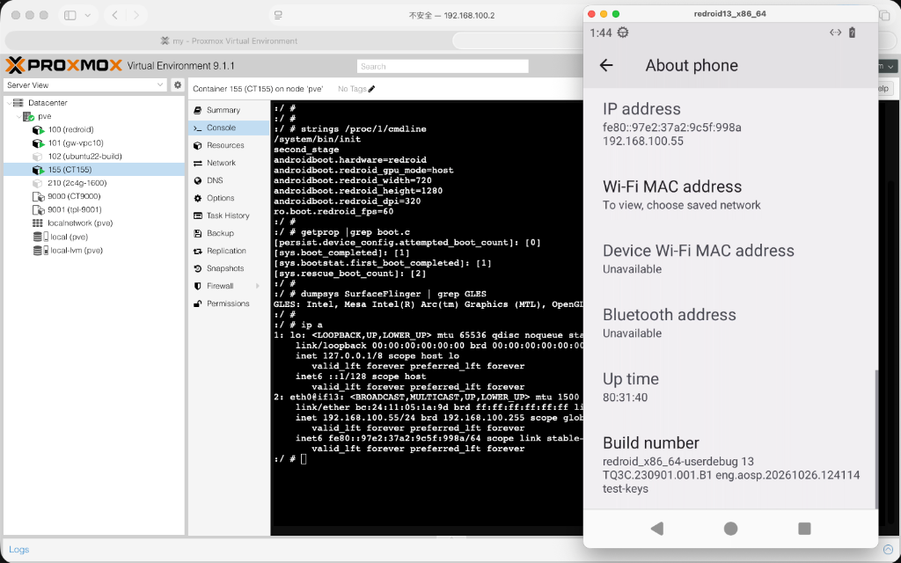
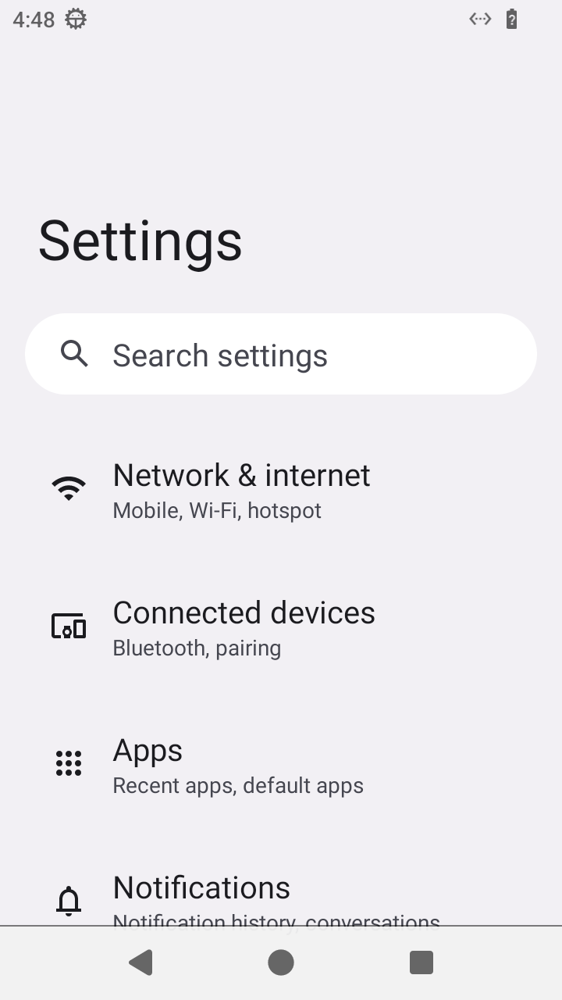
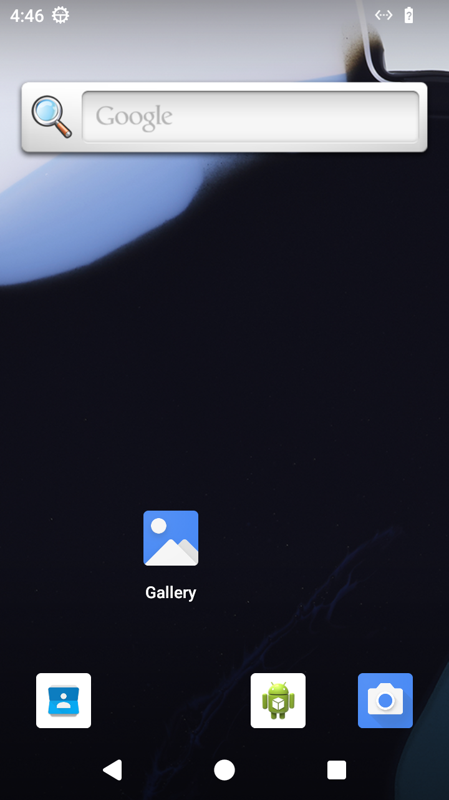

# ReDroid for PVE (redroid-pve)

<p align="center">
  <b>面向 Proxmox VE (PVE) 的原生 Android 13 (AOSP) 容器解决方案</b><br>
  秒级冷启 · 独立局域网 IP · 支持非特权安全隔离 · 消除 Docker 嵌套开销 · 支持秒级快照
</p>

<p align="center">
  <a href="LICENSE"></a>
  <a href="https://github.com/hqw700/redroid-pve/releases"></a>
  <a href="README_EN.md"></a>
</p>

<p align="center">
  
</p>

---

## 1. 架构特性与收益对比

在传统方案中，在 PVE 运行 ReDroid 需要采用 **Docker-in-LXC (PVE ➔ Ubuntu LXC ➔ Docker ➔ ReDroid)** 嵌套架构。本项目通过重构根文件系统、自愈 APEX 动态链接、User Namespace 隔离与宿主机安全加固 Hook，实现了 **Android 直接作为 PVE 原生容器运行**，并支持以**非特权模式 (`unprivileged: 1`)** 启动：

| 评估维度 | 传统 Docker-in-LXC 嵌套方案 | 本项目：PVE 原生容器方案 (`redroid-pve`) |
| :--- | :--- | :--- |
| **拓扑层级** | PVE ➔ Ubuntu CT ➔ Docker ➔ ReDroid (3层) | **PVE ➔ ReDroid CT (1层)** |
| **安全隔离** | 必须 `--privileged` 运行，具备全部宿主能力 | **支持非特权模式 (`unprivileged: 1`)，降低逃逸风险** |
| **冷启动耗时** | 约 30 ~ 50 秒 (需先拉起 Ubuntu 守护进程与 dockerd) | **约 5 秒 (直接拉起 Android /init 渲染至桌面)** |
| **内存底噪开销** | 额外浪费 1.5GB+ 供 Ubuntu 宿主与 Docker 守护驻留 | **零多余驻留内存，内存多开密度提升 30%+** |
| **网络模式** | 繁琐的 Docker NAT 端口映射 (`-p 5001:5555...`) | **局域网原生独立 IP (基于 vmbr0 桥接，5555 直连)** |
| **生命周期控制** | PVE 面板无法感知容器启停，无法做精细资源配额 | **PVE Web 面板直接开机、关机、重启与动态配额** |
| **存储备份与快照** | 无法单机快照，备份宿主会造成全量虚拟机重复备份 | **支持 PVE 单实例秒级快照 (LVM-Thin/ZFS)、秒级回滚与备份** |

---

## 2. 快速部署指南 (3 步开箱即用)

### 第 1 步：下载预编译好的 PVE 容器模板

登录到您的 PVE 宿主机终端，将预编译的高压缩比模板（`.tar.zst`，约 600MB）下载到 PVE 模板缓存目录：

```bash
# 登录 PVE 宿主机 (root 权限)
cd /var/lib/vz/template/cache/

# 下载发布的 v0.0.1 Android 13 x86_64 模板镜像 (约 620MB)
wget https://github.com/hqw700/redroid-pve/releases/download/v0.0.1/redroid13_x86_64_pve_template_2026-10-26.tar.zst
```

---

### 第 2 步：初始化 PVE 宿主机加固 Hook

克隆本仓库并在 PVE 宿主机上执行一键环境初始化：

```bash
# 克隆仓库
git clone https://github.com/hqw700/redroid-pve.git /root/redroid-pve

# 执行一键加固与环境初始化
cd /root/redroid-pve
./deploy/install-hooks.sh
```

> **该脚本自动完成：**
> 1. 开启 PVE `local` 存储对 `snippets` 的支持；
> 2. 部署关键的安全加固挂载 Hook（杜绝容器破坏 PVE 宿主机 `pmxcfs` 或休眠物理机）；
> 3. 安装 `pve-create-redroid` 到系统命令路径。

---

### 第 3 步：一键创建并拉起 Android 容器

直接执行一键创建命令（传入容器 ID、局域网静态 IP 和默认网关，**默认采用非特权安全模式**）：

```bash
# 语法: pve-create-redroid <容器VMID> <静态IP/掩码> <默认网关> [CPU核数] [内存MB] [SwapMB] [磁盘GB] [模板路径] [非特权标志]
# 示例 1：默认以非特权模式 (unprivileged: 1) 创建 CT 201
pve-create-redroid 201 192.168.100.201/24 192.168.100.1

# 示例 2：以特权模式 (unprivileged: 0) 创建（若需要直通特殊内核节点）
pve-create-redroid 201 192.168.100.201/24 192.168.100.1 8 4096 1024 32 "" 0
```

执行后，容器将在约 **5 秒内** 完成初始化并自动达到 `sys.boot_completed=1`！

---

### 第 4 步：连接与预览控制

在局域网内任意客户端电脑（Mac / Windows / Linux）终端中，直接通过原生 ADB 即可连接与投屏：

```bash
# 1. 局域网直连 Android 实例 (标准 5555 端口)
adb connect 192.168.100.201:5555

# 2. 原生低延迟画面投屏与键盘触控 (推荐开源工具 scrcpy)
scrcpy -s 192.168.100.201:5555
```

<p align="center">
  
  
</p>

---

## 3. 非特权运行模式 (`unprivileged: 1`) 技术深度解析

在以往的实践中，Android 容器必须依赖 `--privileged` 运行，否则在 Linux 6.x / PVE 8.x 环境下会遭遇各种内核崩溃与权限拒绝。本项目深入 AOSP 源码，攻克了四大核心壁垒，实现了完整的非特权安全运行：

1. **User Namespace 下原生 BinderFS 兼容 (`0002-patch`)**：
   Linux 内核自 5.0 起原生允许在非特权 userns 下挂载 `binderfs`，但 AOSP 官方 `init.rc` 硬编码了 `stats=global` 选项（此选项要求宿主全局 `CAP_SYS_ADMIN`）。本项目移除此限制后，非特权容器内部可原生、独立创建并管理全套 `binder`、`hwbinder` 与 `vndbinder`。
2. **解除进程优先级与调度配额阻断 (`RLIMIT_NICE: 40`)**：
   Android Framework（`SystemServer.java`）在初始化时强制尝试通过 `Process.setThreadPriority()` 提升系统线程优先级为负值（如 `-2`、`-10`）。非特权环境下 Linux 默认禁止降低 nice 值，会导致抛出 `SecurityException` 崩溃自杀。通过在 LXC 配置注入 `lxc.prlimit.nice: 40`，赋予容器最高优先级调度范围，原生化解冲突。
3. **消除属性存储区溢出导致的 SIGBUS 闪退 (`autodev 128MB`)**：
   Android Bionic 属性存储区（Property Area）每个上下文文件需分配 128KB 共享内存。LXC 默认 `autodev` 分配的 `/dev` tmpfs 仅 500KB，创建第 5 个属性上下文时即耗尽空间，在写内存时触发缺页致命异常 `SIGBUS (signal 7)`。本项目显式为 `/dev` 提供 128MB tmpfs，彻底消除隐患。
4. **移除 BpfMap 构造函数硬编码 `abort()` 缺陷 (`0005-patch`)**：
   在非特权容器下宿主 eBPF 被安全策略限制，上层系统库（如 `libmeminfo`、`libgpuwork`）本具备回退降级逻辑，但底层 `BpfMap.h` 的构造函数硬编码了 `if (mMapFd < 0) abort();`，导致 `gpuservice` 与 `system_server` 崩溃死循环。本项目将其修正为标准降级返回，实现无 eBPF 场景下的平稳运行。

---

## 4. 核心启动参数定制

Android 的启动参数在容器配置文件中通过 **`lxc.init.cmd`** 指定。

编辑配置文件：`nano /etc/pve/lxc/<VMID>.conf`，修改对应行后重启容器（`pct reboot <VMID>`）即可生效：

```ini
lxc.init.cmd: /init androidboot.hardware=redroid androidboot.redroid_gpu_mode=guest androidboot.redroid_width=1080 androidboot.redroid_height=1920 androidboot.redroid_dpi=320 ro.boot.redroid_fps=60
```

| 参数项 | 说明 | 推荐可选值 |
| :--- | :--- | :--- |
| **`androidboot.hardware`** | **必填**，硬件平台标识 | `redroid` |
| **`androidboot.redroid_gpu_mode`** | 图形渲染模式 | **`guest`**：纯 CPU 软件渲染（SwiftShader，零宿主 GPU 依赖，极其通用安定）<br>**`host`**：直通宿主机 GPU 硬件渲染（需宿主机挂载 `/dev/dri`） |
| **`androidboot.redroid_width`** | 屏幕横向分辨率 | 常用：`1080`、`720` |
| **`androidboot.redroid_height`** | 屏幕纵向分辨率 | 常用：`1920`、`1280` |
| **`androidboot.redroid_dpi`** | 屏幕像素密度 DPI | 常用：`320`、`480`、`240` |
| **`ro.boot.redroid_fps`** | 屏幕刷新率帧率 | 常用：`60`、`30` |

---

## 5. 关键安全加固原理 (为什么需要 Hook？)

在特权容器（`unprivileged: 0`）模式或部分直通场景下，Android 容器直接共享宿主机的 `/sys` 虚拟文件系统，存在两大系统级冲突，本项目的加固 Hook 充当了坚固的**护城河**：

1. **防止 Android 破坏 PVE 集群文件系统 (`pmxcfs`)**：
   * PVE 宿主机的 `/etc/pve` 及 Web 认证由基于 FUSE 运行的 `pmxcfs` 承载。
   * Android 原生存储守护进程 `vold` 在初始化以及关机时，会执行 `AbortFuseConnections()` 扫描 `/sys/fs/fuse/connections` 并向所有控制节点写入 `1`。
   * **防御**：`redroid-pve-hook.sh` 在挂载期用只读的独立 1MB tmpfs 覆盖容器内的 `/sys/fs/fuse`，彻底切断 `vold` 破坏宿主机的通道。
2. **防止 Android 休眠物理宿主机**：
   * Android 电源服务（`system_suspend`）息屏时会向 `/sys/power/state` 写入 `mem`，特权容器下会直接导致整台 PVE 物理服务器睡眠断网。
   * **防御**：Hook 将容器内的 `/sys/power/state` 重定向绑定到虚拟空文件，封死休眠指令。
3. **输入设备直通与网络自愈**：
   * 自动在容器内创建 `/dev/uinput` 设备节点（授权 0666），保障 `scrcpy` 鼠标触控与按键无缝映射；
   * `redroid-hook.sh` 在容器 `post-start` 阶段利用 `nsenter` 毫秒级写入静态 IP，避免 Android 触发 `IpClient` NPE 崩溃死循环。

---

## 6. 多版本与多架构支持规划 (Roadmap)

本项目计划逐步扩展对更多主流 Android 版本及 CPU 架构的支持：

| Android 版本 | API 级别 | x86_64 架构 | ARM64 架构 | 状态 |
| :---: | :---: | :---: | :---: | :---: |
| **Android 13** | API 33 | ✅ 官方支持 (支持非特权) | 🔄 规划中 | **GA 稳定版 (推荐)** |
| **Android 11** | API 30 | 🔄 适配中 | 🔄 规划中 | 极低内存挂机首选 |
| **Android 14** | API 34 | 🔄 规划中 | 🔄 规划中 | 高版本兼容性首选 |
| **Android 15** | API 35 | ⏳ 评估中 | ⏳ 评估中 | 前沿特性跟进 |

---

## 7. 从源码自主编译指南 (开发者)

如果希望基于官方 AOSP 源码完全自主编译包含非特权适配补丁的模板：

```bash
# 1. 初始化 AOSP 13.0.0_r82
repo init -u https://android.googlesource.com/platform/manifest -b android-13.0.0_r82 --depth=1 --git-lfs
git clone https://github.com/remote-android/local_manifests.git .repo/local_manifests -b 13.0.0
repo sync -c -j16

# 2. 打入官方 redroid 基础补丁
git clone https://github.com/remote-android/redroid-patches.git
./redroid-patches/apply-patch.sh .

# 3. 打入本项目 PVE 与非特权适配补丁 (patches/android-13/)
git -C vendor/redroid apply /path/to/redroid-pve/patches/android-13/0001-vendor-redroid-pve-lxc-post-fs-data.patch
git -C system/core apply /path/to/redroid-pve/patches/android-13/0002-system-core-unprivileged-container-adaptation.patch
git -C system/bpf apply /path/to/redroid-pve/patches/android-13/0003-system-bpf-unprivileged-adaptation.patch
git -C system/memory/lmkd apply /path/to/redroid-pve/patches/android-13/0004-system-memory-lmkd-unprivileged-adaptation.patch
git -C frameworks/libs/net apply /path/to/redroid-pve/patches/android-13/0005-frameworks-libs-net-bpfmap-abort-fix.patch
git -C external/toybox apply /path/to/redroid-pve/patches/android-13/0006-external-toybox-accurate-cpu-mem-for-containers.patch

# 4. 编译系统
source build/envsetup.sh
lunch redroid_x86_64-userdebug
m -j$(nproc)

# 5. 生成 PVE 模板归档 (.tar.zst)
./build/mk-pve-template.sh
```

---

## 8. 许可证

本项目采用 [Apache-2.0 License](LICENSE) 开源协议。
ReDroid 是 [remote-android](https://github.com/remote-android) 组织的开源项目，遵循其官方许可协议。
