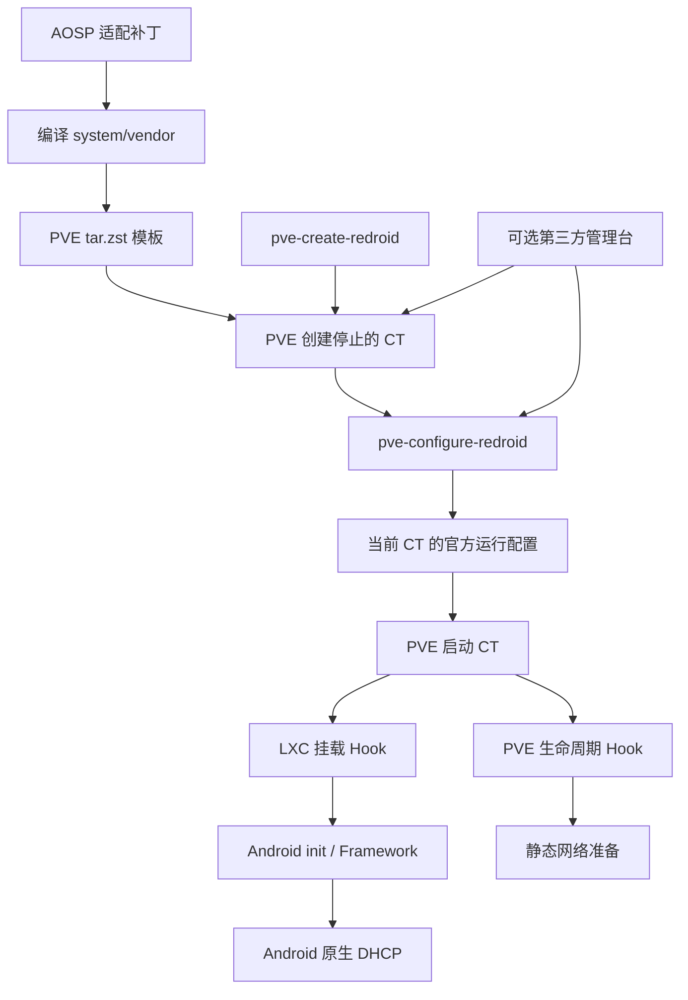

# 架构与职责

返回 [文档入口](README.md)。接口细节见 [运行接口](runtime-api.md)。

## 组件关系

`pve-create-redroid` 是原生便利入口，内部调用 PVE 创建和官方配置接口。PVE GUI 和第三方管理台也可以直接创建 CT，再调用同一配置接口，不需要另一套 Android 启动模板。

## 所有权划分

| 组件 | 负责 | 不负责 |
| --- | --- | --- |
| PVE | CT、CPU/内存、存储卷、网卡、任务、快照、启停 | Android Framework 适配 |
| redroid-pve 运行时 | Android/PVE 启动参数、设备、GPU、基础挂载、网络准备、宿主保护 | 管理台业务状态、计费和租约 |
| AOSP 补丁与镜像 | Binder、APEX、BPF/LMKD 兼容、统计、IpClient 配置和闹钟回退 | 宿主资源分配与控制台注册 |
| 可选管理台 | 资源选择、任务追踪、实例归属、自己的 Agent 与配置挂载 | 重写官方运行配置或 DHCP 客户端 |

## 配置接口与两个 Hook

- `pve-configure-redroid.py`：读取停止 CT 的实际配置，按特权模式渲染官方管理块。默认使用宿主 GPU，缺少指定 render node 时明确报错。
- `redroid-pve-hook.sh`：LXC 挂载阶段处理基础设备、FUSE/电源保护和网络相关准备；DHCP 启动前检查实际客体 ipconfigstore 的能力标记。
- `redroid-hook.sh`：PVE 生命周期入口，在启动后准备客体链路；静态模式设置客体地址/路由，DHCP 模式只准备链路，租约交给 Android。

安装器读取 `local` 目录存储的位置，向其 content 追加 `snippets`，将 PVE Hook 放入该存储。它不会下载镜像或创建 CT。

宿主 BinderFS 准备统一由配置器的 `--prepare-host` 提供，安装器与 pre-start Hook 调用同一实现。只读 `--check-host` 供原生排障和第三方预检使用；宿主模块支持不应依赖 Android 尝试挂载时自动加载。

| 安装路径 | 用途 |
| --- | --- |
| `/usr/local/bin/pve-configure-redroid` | 官方配置与查询接口 |
| `/usr/local/bin/pve-create-redroid` | 原生创建便利入口 |
| `/usr/local/share/redroid-pve/VERSION` | 运行脚本版本 |
| `local:snippets/redroid-hook.sh` | PVE 生命周期 Hook |
| `/usr/share/lxc/hooks/redroid-pve-hook.sh` | LXC 挂载 Hook |

## 配置边界与幂等性

配置器管理 `# BEGIN redroid-pve runtime` / `# END redroid-pve runtime` 及已知历史运行键，保留无关挂载、资源配置和快照段。它会调整 `features` 中的 nesting/mknod，并从 `net0` 推导网络启动参数。其他 PVE hookscript 会被拒绝，需先设计 Hook 链接。

配置器不改变已有 CT 的 `unprivileged` 模式。原生创建默认非特权；第三方管理台可以显式选择特权。模式不同会影响设备挂载和 cgroup 规则，不能仅修改一行配置就视为完成模式迁移。

运行配置包含 `lxc.apparmor.profile: unconfined` 和设备访问授权；支持非特权不代表取消所有宿主风险。FUSE、电源和设备权限保护应检查实际效果，尤其是 Hook 中使用了容错处理的挂载步骤。

## 镜像补丁分工

| 编号 | AOSP 子项目 | 作用 |
| --- | --- | --- |
| 0001 | `vendor/redroid` | PVE/LXC post-fs-data 与 APEX 环境适配 |
| 0002 | `system/core` | 非特权容器的 init/Binder 等基础兼容 |
| 0003 | `system/bpf` | 缺少可用 BPF 能力时的适配 |
| 0004 | `system/memory/lmkd` | 容器内 LMKD 兼容 |
| 0005 | `frameworks/libs/net` | BpfMap 失败路径不直接 abort |
| 0006 | `external/toybox` | 容器 CPU/内存统计适配 |
| 0007 | `vendor/redroid` | DHCP/STATIC 区分及 ipconfigstore 错误处理 |
| 0008 | `frameworks/base` | 无内核闹钟驱动时投递 DHCP listener 闹钟 |
| 0009 | `system/core` | memfd 固定尺寸保护，兼容新版 WebView 共享内存校验 |

0007 和 0008 是 DHCP 的配套要求。检查标记只证明模板具备声明的网络组件，不能证明 Framework、DNS、续租和整机开机全部可用。

## 网络和状态

DHCP 使用 Android Ethernet → IpClient → DhcpClient；容器停止后进程与网络命名空间退出，不存在本项目另行维护的宿主租约进程。静态路径继续通过官方 Hook 和镜像中的网络组件工作。

`--network-status` 观察当前命名空间地址和路由，并从 Android Ethernet 服务读取 DHCP DNS。ready 只表示观察到 IPv4，不等于互联网连通、Android boot completed 或远程投屏正常。详见 [网络与 DHCP](networking.md)。
